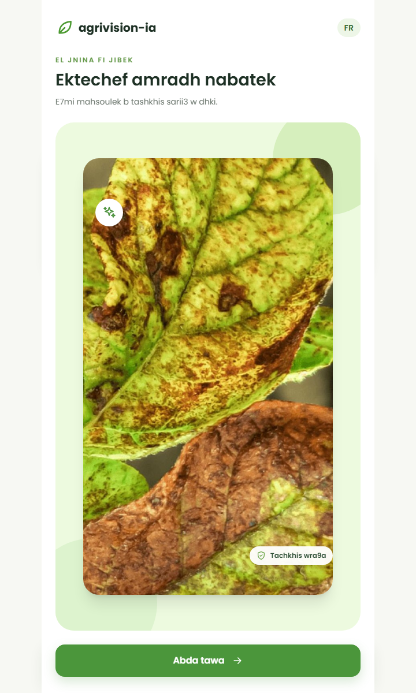
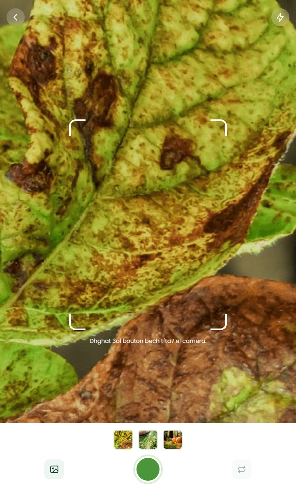
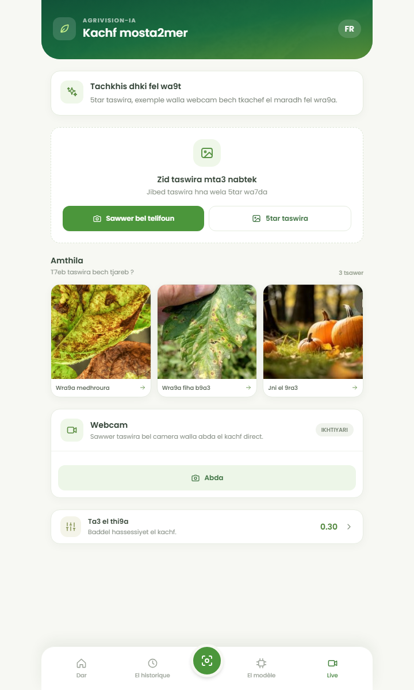
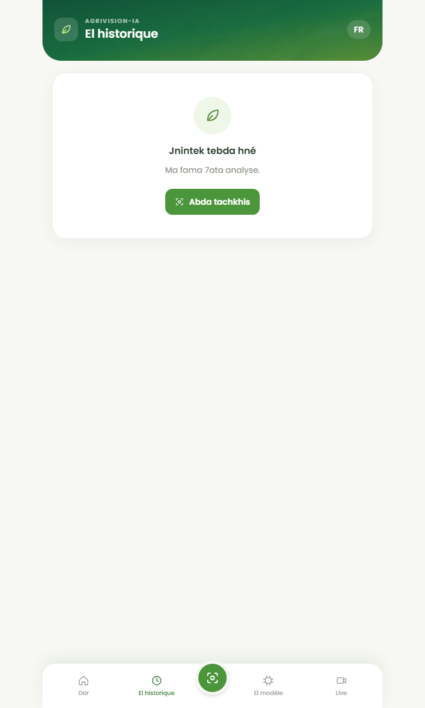
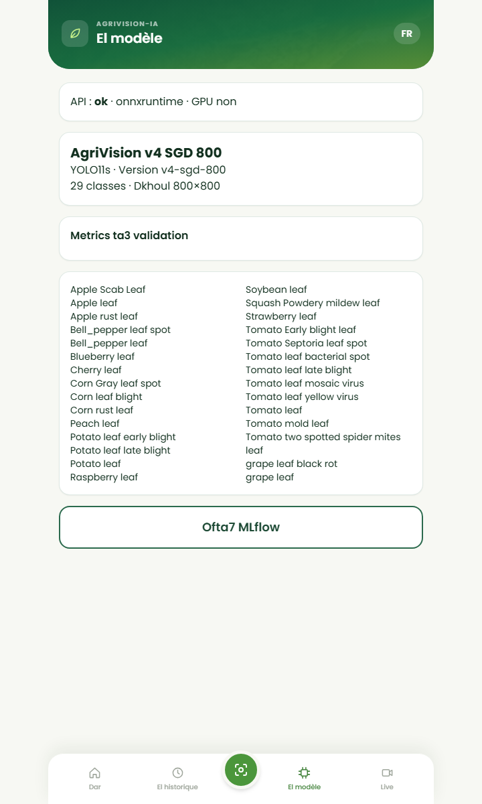

# Rapport complet du projet AgriVision IA

**Date du rapport : 10 novembre 2026**  
**Application :** agrivision-ia  
**Objet :** synthèse de l’application, du modèle, des intégrations réalisées, des vérifications et des limites connues.

## 1. Résumé

AgriVision IA est une application web mobile de détection de maladies et d’anomalies foliaires. L’utilisateur peut fournir une image, choisir un exemple ou utiliser la caméra. Le frontend React envoie l’image à une API FastAPI, qui exécute un modèle YOLO exporté en ONNX, puis renvoie les classes détectées, leurs scores et leurs boîtes englobantes.

Le modèle d’entraînement **AgriVision v4 SGD 800**, entraîné sur Kaggle, est intégré au backend. Il possède 29 classes, prend des entrées de 800 × 800 pixels et ses métadonnées rapportent un mAP@50 de **0,6603** et un mAP@50–95 de **0,5119** sur le jeu de test du run. Les poids, classes et métriques ont également été importés dans MLflow.

L’application propose un accueil mobile, une page de scan, un mode Live, un historique local et une page d’informations sur le modèle. La détection continue par webcam est prévue dans le navigateur, mais elle dépend de l’autorisation caméra et d’un contexte HTTPS sécurisé sur téléphone.

## 2. Besoin et objectifs

Le travail a porté sur les objectifs suivants :

- rapprocher l’interface d’une maquette de produit agricole mobile;
- rendre les pages d’accueil, de scan, de Live et d’historique cohérentes;
- remplacer la marque LeafDoctor par **agrivision-ia**;
- afficher des exemples photographiques réels;
- permettre l’analyse d’images et la détection sur le flux vidéo;
- clarifier le fonctionnement de la caméra sur téléphone;
- intégrer le modèle v4 fourni et enregistrer ses artefacts dans MLflow.

## 3. Architecture générale

```text
Navigateur / PWA React
    ├── Image, galerie ou webcam
    ├── Historique stocké sur l’appareil
    └── Requêtes HTTP /api
             │
             ▼
       API FastAPI
             │
             ▼
    ONNX Runtime + best.onnx

Entraînement réalisé sur Kaggle
    └── best.pt, best.onnx, classes et métadonnées
             │ import des artefacts
             ▼
        Serveur MLflow
```

### Technologies principales

| Partie | Technologies et rôle |
|---|---|
| Interface | React, Vite, React Router, Tailwind CSS |
| API | Python, FastAPI, Pydantic |
| Inférence | YOLO exporté en ONNX, ONNX Runtime, NumPy et Pillow |
| Entraînement | Ultralytics YOLO; entraînement effectué sur Kaggle |
| Suivi d’expériences | MLflow avec stockage de métadonnées SQLite et artefacts servis par le serveur |
| Conteneurisation | Docker Compose |
| Données et pipeline ML | DVC et scripts Python prévus pour la préparation, l’entraînement, l’évaluation et l’export |

## 4. Fonctionnalités de l’application

### 4.1 Interface et navigation

- Interface mobile-first avec navigation entre Accueil, Scanner, Historique, Modèle et Live.
- Marque **agrivision-ia** dans l’interface et les éléments PWA.
- Écrans disponibles en français et en derja tunisienne.
- Page d’accueil avec entrée vers le diagnostic, statistiques calculées à partir de l’historique de l’appareil et conseils de prise de photo.
- Galerie de trois exemples photographiques.

### 4.2 Analyse et résultats

- Sélection ou dépôt d’une image.
- Compression côté client avant l’envoi à l’API afin de réduire le volume transféré.
- Réglage du seuil de confiance.
- Présentation des détections, classes, scores, boîtes et informations de latence.
- Route d’API séparée pour obtenir une image annotée.

### 4.3 Webcam et détection vidéo

- Le navigateur peut demander l’accès à la caméra arrière avec `getUserMedia`.
- La détection continue prend successivement des images de la vidéo, les envoie au backend et affiche les boîtes de détection sur une superposition canvas.
- Un indicateur Live affiche la cadence observée.
- Les erreurs usuelles de permissions, de caméra absente ou déjà utilisée affichent un message adapté.
- La capture photo native et le choix d’une image restent proposés comme solutions de repli.

La vidéo en direct sur téléphone nécessite HTTPS et une autorisation caméra. Un tunnel Quick Cloudflare a été utilisé pour fournir une URL HTTPS temporaire vers le serveur local. Cette URL n’est pas permanente. Le domaine Vite autorisé dans la configuration est actuellement celui du tunnel utilisé pendant les essais; si Cloudflare en attribue un autre, il faudra mettre à jour `server.allowedHosts` et redémarrer Vite. La disponibilité réelle de la caméra dépend aussi du navigateur et des réglages du téléphone.

### 4.4 Historique

- Les 20 dernières analyses et leurs miniatures sont stockées dans le `localStorage` du navigateur.
- Recherche par étiquette, filtres et confirmation avant effacement.
- Cet historique n’est pas un historique serveur et n’est pas synchronisé entre appareils.

### 4.5 Informations sur le modèle

La page Modèle interroge `/health` et `/model/metadata`; elle affiche l’état de l’API, le moteur d’inférence, la disponibilité GPU, la version, la taille d’entrée, les métriques publiées et les classes.

### 4.6 Captures de l’application

Les captures suivantes illustrent les principaux écrans en format portrait. Les textes visibles sont en derja tunisienne, langue proposée en plus du français.

#### Accueil



#### Scanner



#### Mode Live



#### Historique



#### Informations sur le modèle



## 5. Modèle AgriVision v4

### 5.1 Fichiers intégrés

Les fichiers suivants se trouvent directement dans `models/` :

- `best.onnx` : modèle utilisé par l’API;
- `best.pt` : poids PyTorch originaux;
- `classes.txt` : noms des classes dans l’ordre attendu;
- `model_metadata.json` : métadonnées du run d’entraînement;
- `metadata.json` : métadonnées normalisées consommées par l’API.

Le backend charge `best.onnx` et vérifie que le nombre de classes de sa sortie correspond à `classes.txt`. La taille de l’entrée ONNX détectée est **800 × 800**.

### 5.2 Classes et métriques

Le modèle comprend **29 classes** de feuilles saines et de maladies concernant notamment la pomme, le maïs, la pomme de terre, le poivron, le soja, la courge, le fraisier, la vigne et la tomate.

Les valeurs présentes dans les métadonnées du run Kaggle sont :

| Métrique de test rapportée | Valeur |
|---|---:|
| mAP@50 | 0,6602818298 |
| mAP@50–95 | 0,5119164345 |
| Seuil de confiance recommandé | 0,25 |
| Seuil IoU | 0,45 |

Ces métriques sont rapportées par les métadonnées du modèle. Les données de validation détaillées, les résultats par époque et les courbes d’entraînement n’étaient pas présents dans les fichiers importés; ils ne sont donc pas représentés comme des résultats MLflow.

### 5.3 Inférence

Le backend :

1. ouvre l’image et la convertit en RGB;
2. conserve ses proportions et la redimensionne avec padding (« letterbox »);
3. exécute le tenseur avec ONNX Runtime;
4. applique le seuil de confiance et la suppression non maximale par classe;
5. remet les boîtes aux coordonnées de l’image originale;
6. renvoie les étiquettes, scores, tailles d’image, seuils et temps d’inférence.

Le serveur Docker a confirmé le chargement du modèle avec 29 classes sur **CPU** (`gpu_available: false`). Une requête d’inférence de contrôle a renvoyé une réponse valide. Cette requête technique ne constitue pas une mesure indépendante de précision du modèle.

## 6. API

L’API est documentée avec Swagger à `/docs`.

| Route | Fonction |
|---|---|
| `GET /health` | État du service et présence du modèle |
| `GET /model/metadata` | Informations du modèle et liste des classes |
| `POST /predict` | Détection sur une image |
| `POST /predict/visualize` | Détection et image annotée encodée en base64 |

L’API impose une limite de téléversement configurable, fixée par défaut à 10 Mo. Elle retourne notamment des erreurs pour image invalide, fichier trop lourd, requête invalide ou modèle indisponible.

## 7. MLflow et import depuis Kaggle

L’entraînement est effectué sur Kaggle; il ne démarre pas depuis les machines locales. Les fichiers issus de Kaggle sont importés dans MLflow après leur copie dans `models/`.

### Import effectué

- Expérience MLflow : **`agrivision-ia-v4`**.
- Run importé : **`AgriVision_v4_sgd_800_import`**.
- Statut vérifié : **FINISHED**.
- Artefacts vérifiés : `best.onnx`, `best.pt`, `classes.txt`, `metadata.json`, `model_metadata.json`.
- Métriques enregistrées : `test_map50` et `test_map50_95`.
- Paramètres enregistrés : nom du run, taille d’image, nombre de classes, seuil de confiance et seuil IoU.

Lien local vers le run importé : [MLflow — run AgriVision v4](http://localhost:5000/#/experiments/2/runs/350d13a959e74e89bd6c442e91fb3d15).

L’expérience initiale `agrivision-ia` avait une destination d’artefacts locale au conteneur, inaccessible pour l’import depuis Windows. Une nouvelle expérience utilisant l’URI d’artefacts proxifiée `mlflow-artifacts:/` a été configurée pour les imports et entraînements ultérieurs. Le serveur MLflow Docker est configuré avec stockage persistant et service d’artefacts.

Pour importer un autre modèle exporté depuis Kaggle :

```powershell
docker compose up -d mlflow
.\.venv-ml\Scripts\python.exe scripts\import_model_mlflow.py
```

Le script lit les classes, métriques et paramètres dans `models/model_metadata.json`. Il importe les fichiers fournis, mais ne peut pas inventer les métriques par époque ou les courbes absentes. Pour les ajouter, il faut aussi récupérer depuis Kaggle les fichiers correspondants, par exemple `results.csv` et les graphiques.

## 8. Déploiement et utilisation

### Développement local

- Frontend Vite : port `5173`.
- Backend FastAPI : port `8000`.
- Le proxy Vite relaie `/api` vers le backend.

### Docker

`docker-compose.yml` orchestre le backend, le frontend et MLflow. Le modèle est monté en lecture seule depuis `models/` vers `/models` dans le conteneur backend.

Commande de démarrage :

```powershell
docker compose up --build
```

MLflow peut ensuite être consulté sur `http://localhost:5000`.

Pour la caméra vidéo sur téléphone, ouvrir le frontend par une adresse HTTPS. Une adresse locale telle que `http://192.168.x.x:5173` ne fournit pas un contexte sécurisé. Le tunnel Cloudflare utilisé lors des essais relaie le serveur Vite de développement; il faut laisser Vite et `cloudflared` fonctionner.

## 9. Pipeline d’entraînement prévu dans le dépôt

Les scripts et la configuration contiennent un pipeline DVC/Ultralytics/MLflow local :

1. préparer les jeux de données dans `data/raw/`;
2. construire les données traitées et leur `data.yaml`;
3. entraîner avec `src/models/train.py`;
4. évaluer avec `src/models/evaluate.py`;
5. exporter ONNX et mesurer la parité/performance avec `src/models/export_onnx.py`;
6. éventuellement enregistrer le modèle dans le registre MLflow.

Le pipeline suppose des datasets locaux structurés; au moment de ce rapport, `data/raw/` et `data/processed/` ne contenaient que des fichiers `.gitkeep`. Un essai d’entraînement local a donc échoué avant la première époque, faute de `data/processed/data.yaml`. **Aucun nouvel entraînement n’a été réalisé localement** : le modèle v4 utilisé ici provient du run Kaggle.

Le pipeline local existant produit aussi `models/best.pt` et vise un entraînement configuré à 640 pixels, tandis que le modèle actif v4 est en 800 pixels. Ces deux parcours ne doivent pas être confondus : un futur export local ne remplace pas automatiquement le modèle actif. Le modèle candidat doit être évalué, exporté, accompagné de ses classes et métadonnées, puis déployé explicitement.

## 10. Vérifications réalisées

| Vérification | Résultat |
|---|---|
| Chargement ONNX du modèle v4 | Réussi : 29 classes, entrée 800 × 800 |
| Inférence de contrôle via le modèle | Réponse valide |
| `/health` dans le backend Docker après correction du chemin | `status: ok`, modèle chargé, version `v4-sgd-800`, CPU |
| `/model/metadata` | Réponse valide avec 29 classes |
| Import MLflow | Run terminé; métriques et cinq fichiers d’artefact vérifiés |
| Tests backend | 12 tests réussis |
| Frontend | Build et lint réussis; tests frontend réussis (3 tests) |
| Caméra sur appareil réel | Non certifiée par les tests automatisés; dépend des permissions, du navigateur et de l’HTTPS |

## 11. Limites et précautions

- Les métriques proviennent des métadonnées fournies pour le run Kaggle; les rapports d’évaluation complets n’ont pas été importés.
- Les exemples de MLflow importés sont des artefacts d’un modèle existant, pas un entraînement enregistré en direct époque par époque.
- L’historique reste dans le stockage local du navigateur.
- La webcam sur mobile requiert HTTPS, une autorisation du site et un navigateur compatible.
- Le tunnel Quick Cloudflare est temporaire; son URL peut changer.
- L’inférence Docker observée utilise le CPU. Aucune accélération GPU n’a été constatée.
- Les datasets sources PlantDoc/PlantSeg ne sont pas présents localement dans `data/raw/`; l’entraînement nécessite leur disponibilité là où le pipeline est exécuté.
- Le modèle est une aide à la décision; ses prédictions ne remplacent pas une expertise agronomique.
- Une incohérence documentaire reste à vérifier : le README annonce l’application sur le port 8080, alors que le mapping actuel de Compose expose `8090:80`.

## 12. Prochaines étapes recommandées

1. Sauvegarder depuis Kaggle les sorties complètes du run — `results.csv`, courbes, matrice de confusion et paramètres — puis les importer dans MLflow.
2. Mettre à jour le script d’import pour accepter les répertoires d’artefacts Kaggle en plus des poids individuels si les prochains runs produisent des fichiers supplémentaires.
3. Tester la caméra vidéo sur le téléphone cible avec le lien HTTPS, en confirmant les permissions et la détection d’une feuille réelle.
4. Stabiliser un nom de domaine HTTPS pour remplacer le tunnel éphémère lors d’une démonstration durable.
5. Corriger la documentation du port de déploiement Docker après avoir choisi l’URL d’accès voulue.
6. Évaluer toute nouvelle version sur un jeu de validation indépendant avant de remplacer le modèle v4 utilisé par l’application.

## 13. Fichiers de référence

- Interface : `frontend/src/pages/`, `frontend/src/components/`, `frontend/src/i18n.js`.
- Caméra et détection continue : `frontend/src/components/WebcamCapture.jsx`.
- Appels frontend : `frontend/src/services/api.js`.
- API et inférence : `backend/app/main.py`, `backend/app/inference.py`, `backend/app/schemas.py`.
- Modèle actif et classes : `models/best.onnx`, `models/best.pt`, `models/classes.txt`, `models/metadata.json`, `models/model_metadata.json`.
- Import MLflow du modèle Kaggle : `scripts/import_model_mlflow.py`.
- Entraînement et export : `src/models/train.py`, `src/models/evaluate.py`, `src/models/export_onnx.py`.
- Préparation des données : `src/data/dataset.py`.
- Configuration : `params.yaml`, `docker-compose.yml`, `frontend/vite.config.js`.
